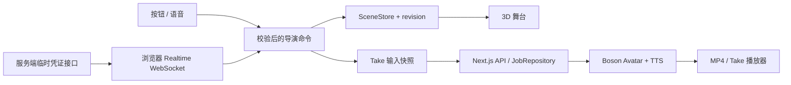

# AI Director Studio：五阶段开发与验收方案

> 日期：2026-10-23。依据：仓库内 `PROJECT_HANDOFF_AI_DIRECTOR_STUDIO.md` 与下列官方资料。
> 本方案编写时仓库仅有 handoff。当前已实施 Stage 1–4；实际交付和证据分别见 docs/STAGE1_VALIDATION.md 至 docs/STAGE4_VALIDATION.md。Stage 4 的主观情绪听感仍待人工确认。方案本身不代替运行验收。
> 以下 `/api/*`、数据结构、阈值和阶段安排均为项目设计，不是 Boson 原生协议。

## 一、项目理解与交付范围

面向短视频创作者与影视学生，制作一个“能用语音导演的虚拟片场”：在固定审讯室中，调整演员、外形、服装、动作、镜头与灯光，再指定台词和情绪生成表演，通过 Retake 比较不同版本。

完整演示闭环：

1. 说“换成演员 B，穿黑色西装，向右转 45 度并挥手”。舞台真实变化。
2. 说“镜头推近，灯光暗一点”。机位与灯光变化。
3. 说“害怕地说：I didn't do it.，Action”。生成 Take 1。
4. 说“保持其他内容，只改成愤怒，再来一次”。生成 Take 2。
5. 切换两个 Take，证明台词、演员、服装、构图配置保持一致，情绪不同。

### 产品边界

- **3D 舞台**：确定性、即时、可编辑的预演空间。修改来自预设资产和受约束的工具调用。
- **表演输出**：Avatar 生成二维说话视频；不承诺生成完整 3D 电影、不承诺视频精确保留机位运动或身体动画。
- **Retake**：对已选 Take 的不可变输入快照作局部修改。输入一致可以验证；生成视频像素或身份细节完全一致不能保证。
- MVP：一个房间、一个活跃演员、2–3 个角色预设、至少一个真实外形 morph、一组兼容换装、Idle/Wave、相机和灯光控制、双语语音、情绪表演、Take 历史与错误恢复。
- 不纳入 MVP：自由生成模型/衣服、多人表演、完整时间线、3D 面捕回放、任意角色通用换装。

### 比赛适配

建议主赛道选择 **Agents That Act**：语音能执行有可见结果的导演操作；同时体现 Conversation as the Interface 和 Put a Face to the Voice。官网允许使用单个或组合模型，并未要求全部使用；本项目组合三类能力是产品选择。评分侧重 Higgs 使用 30%、体验 25%、创新 25%、技术执行 20%。因此应优先打通操作与 Retake，而不是堆积功能。[比赛官网](https://www.boson.ai/hackathon)

## 二、已核对的能力与架构决策

| 能力 | 用途 | 实现约束 |
|---|---|---|
| Higgs Realtime | 听指令、理解、调用工具、反馈执行结果 | 浏览器使用服务端签发的临时凭证；模型不直接操作 Three.js 对象 |
| Higgs TTS 3 | 角色情绪台词 | MVP 通过 Avatar 的 `input_tts` 使用；独立 TTS 用于前期验证，可后续提供试听 |
| Higgs Avatar | 根据人像和台词生成说话视频 | 异步任务；查询完成后取 MP4；不是 3D 动画接口 |
| Three.js / R3F | 可视化舞台、真实几何修改、动作播放 | morph 和动画必须真实存在于资产中 |
| MediaPipe | 从视频估计表情、尝试映射到 3D | 仅可选增强，不作为核心验收前置条件 |

具体协议注意事项：

- Realtime 地址 `wss://api.boson.ai/v1/realtime`。服务端调用 `POST /v1/realtime/client_secrets`，浏览器通过 `realtime`、`bai-client-secret.<value>` 子协议连接；按返回的 `expires_at` 管理有效期。每次新连接重新获取临时凭证。`session.update` 使用 `higgs-realtime`，`output_modalities` 只能选 `["audio"]` 或 `["text"]`，不能混用。[连接与会话](https://docs.boson.ai/models/higgs-realtime/guides/connections-and-sessions)
- 采音使用 AudioWorklet 输出 PCM16 单声道，按会话配置重采样；浏览器采集常为 48 kHz，不能把 MediaRecorder 的 WebM 数据当作 PCM。默认可按 24 kHz 接入。[音频与声音](https://docs.boson.ai/models/higgs-realtime/guides/audio-and-voices)
- 只在完整工具参数到达后执行；以 `call_id` 去重，把执行结果作为 `function_call_output` 回传，再请求模型继续回复。[工具调用](https://docs.boson.ai/models/higgs-realtime/guides/tool-calling)
- 用户插话时停止本地回复音频，并按实际播放进度截断会话音频上下文，避免模型把未听到的内容视为已听到。停止播放器不等于取消 Avatar 云端任务。[打断机制](https://docs.boson.ai/models/higgs-realtime/guides/turn-detection-and-interruptions)
- Avatar 的 `ref_image` 搭配 `input` 音频或 `input_tts` 二选一。MVP 采用后者，避免重复生成一遍 TTS。接口示例中出现的可选字段不能全部照搬。[Avatar 输入](https://docs.boson.ai/models/higgs-avatar/input-options)
- TTS 情绪用官方支持的 inline tags 生成；由受控模板转换项目的 `fear/anger/neutral`，不将模型随意生成的标签直接发送。[标签说明](https://docs.boson.ai/models/higgs-tts/tags)
- 独立 TTS 默认返回音频二进制；启用 timestamps 时返回结构不同，而且不能同时流式输出。MVP 不依赖词级字幕。[Speech API](https://docs.boson.ai/api-reference/audio/create-a-speech)
- Avatar 创建、查询、下载分开处理；`/content` 是 MP4 字节流，完成前不可当成已存在视频，更不能调用 `.json()` 解析。[创建任务](https://docs.boson.ai/api-reference/videos/create-a-video)、[查询任务](https://docs.boson.ai/api-reference/videos/retrieve-a-video)、[下载视频](https://docs.boson.ai/api-reference/videos/download-content)

### 推荐技术结构

Next.js App Router + TypeScript + React Three Fiber/drei + Zustand + Zod；资产优先统一一种格式。已有可用 VRM 则使用 three-vrm，否则选择具有 morph、骨骼和动画的 GLB，避免在 MVP 同时维护两套完整适配器。



核心数据约定：

- `SceneState`：`revision`、稳定的 `actorId`、可替换的 `presetId`、transform、appearance、outfit、animation、camera、lights、dialogue、emotion。
- `AssetManifest`：资产 URL、许可、支持的 morph 名称与范围、服装兼容关系、动画名称、预设人像。
- `TakeInput`：深拷贝的 SceneState、台词、情绪、声音配置、参考人像版本/哈希、模型配置、`baseTakeId`。
- `TakeJob`：`takeId/requestId/videoId/status/error`；输入创建后不再修改。任务结果只能按 takeId 更新，不能偷偷切换用户当前选择。
- appearance 与 expression 分开：眼睛大小等静态外形不与眨眼、说话等动态表情共用一份状态。
- 浏览器 localStorage 仅存轻量项目元数据；不存密钥、大型 base64 或 MP4。Blob URL 不作为持久视频地址。
- 为可靠去重和重启恢复，单机演示采用 SQLite 的 `JobRepository` 存任务及 requestId 唯一约束。若部署无持久磁盘或多实例，换共享数据库/存储；不能声称内存 Map 能跨实例去重。

## 三、五个开发阶段

建议按总可用开发时间分配 15% / 25% / 20% / 25% / 15%，不是工期保证。云端生成延迟和资产准备时间应在第一阶段实测后重新评估。每阶段以验收门槛推进。

### Stage 1 — 验证 API 与角色资产，消除关键不确定性（15%）

**需求与交付**

- 确认账户能使用 Realtime、TTS 3、Avatar，记录真实响应和生成耗时。
- 找到合法可用且支持目标编辑的角色，形成能力清单。
- 搭建最小 Next.js 页面、服务端配置、API 适配层与开发诊断页。

**实现方法**

1. 将 Boson 主密钥放服务端环境变量；提供无密钥的 `.env.example`。开发诊断页显示服务状态，不显示密钥。
2. 建立 Realtime 凭证接口、TTS 调用适配器、Avatar 创建/查询/下载适配器。超时、上游拒绝、限流统一转换成可解释错误。
3. 用短句先验证 TTS，再用官方示例人像验证 Avatar；成功后用项目角色截图重复一次，分别判断“协议可用”和“角色画面可用”。
4. 检查模型的 morphTargetDictionary、骨骼、动画和衣服；至少一个形态参数须有明显实际几何变化。仅有滑块或同名 metadata 不算支持。[Three.js Mesh](https://threejs.org/docs/pages/Mesh.html)、[three-vrm](https://github.com/pixiv/three-vrm)
5. 制作独立人像拍摄相机：正面、无遮挡、固定灯光、脸部可辨。优先从当前角色外形/服装渲染截图供 Avatar 使用，不直接用可能过暗、侧脸的导演镜头截图。
6. 实测该截图的 Avatar 表现。若效果差，采用精选预设人像，但 UI 明示“表演使用预设人像，外形编辑尚未同步”，不得把这部分描述成已贯通。

**API 测试计划**

- A1：临时凭证能建立会话；服务端返回 `value/expires_at`；过期凭证与无效凭证产生可识别失败。
- A2：短句 TTS 返回可解码、时长大于零的音频；fear/anger 的请求标签符合模板。
- A3：一次 Avatar 创建得到 ID，轮询到 completed，下载得到可解码 MP4；记录总耗时与时长。
- A4：模拟 401/429/5xx、请求超时、任务 failed，校验错误映射；限流不触发无限重试。
- A5：校验缺失 ref_image、同时传 input/input_tts 等非法输入由本地 schema 拒绝，不消耗上游调用。

**浏览器测试计划**

- B1：在 Chrome/Edge 的 localhost 或 HTTPS 页面点击连接，真实麦克风说一句话并听到回复；检查权限拒绝后的引导和重试。
- B2：浏览器播放 TTS 与 MP4，确认有声音、图像可见、无静音自动播放假成功。
- B3：在资产页切换每个角色，检查服装和动画；把 morph 从最小调至最大，保存前后截图证据。
- B4：对比当前 3D 人像和生成视频，人工评估脸部、服装、风格是否可接受，记录局限。

**退出条件**：三类真实接口各跑通最小闭环；至少一套演员具备真实 morph/换装/动作；确定可展示的人像方案。若缺少凭证，只能记为“模拟通过、真实验证阻塞”，不能宣告本阶段完成。

### Stage 2 — 完成按钮可操作的 3D 导演台（25%）

**需求与交付**

固定审讯室、角色切换、外形编辑、换装、转身/Wave、镜头和灯光控制全部可手动操作；无语音也能完成场景搭建。

**实现方法**

1. 建立唯一 SceneStore 和命令执行器；React 面板与后续语音都调用同一组命令。
2. 每次命令校验能力与数值边界，成功才修改状态并增加 revision。失败保留原状态，返回明确原因。
3. 角色替换保持 actorId、位置、朝向、相机、灯光、台词；按新资产能力处理服装/morph/动画。不能支持的字段回退并告知用户，不能静默假成功。
4. 相机保存目标状态，渲染层插值；转角单位、旋转坐标系、距离上下限写入 schema，防止连续 dolly 穿进人物。
5. 动画播放与状态更新分开，确保 Wave 后回 Idle。异步加载使用加载序号，避免快速切换 A→B 后 A 的迟到结果覆盖 B。
6. 增加开发专用状态诊断视图，方便检查 revision 和实际生效参数；验收仍需观察真实画面。

**API / 命令测试计划**

- A6：每种命令正常值、边界值、非法值、未知 actor/morph/outfit；无效输入不改变状态。
- A7：角色替换前后比较不应改变的字段；不兼容参数按既定规则回退。
- A8：相同初态执行相同命令得到相同终态；相对旋转和绝对旋转语义分离。
- A9：批量命令先完整校验再提交；任一不支持时整批拒绝并解释。MVP 选择此原子语义，减少半成功歧义。
- 本阶段核心是本地命令接口测试，无需为测试而把场景状态额外做成远程 REST API。

**浏览器测试计划**

- B5：按“换演员→换装→改眼睛→转身→挥手→推镜→调暗”顺序操作；同时观察 UI 数值和画布变化。
- B6：快速切换角色、重复 Wave、连续拖动滑块；无模型重影、状态回跳或多重动画叠加异常。
- B7：模拟模型加载失败，显示重试；已有可用场景仍可操作。
- B8：演示机器 1280×720 和 1920×1080 下布局可用；目标正常操作不持续低于 30 FPS，记录实际硬件和帧率，不能只报理想值。

**退出条件**：所有 MVP 操作通过手动路径完成；至少一组截图证明形态真实改变；不支持的能力可解释失败。

### Stage 3 — 接入实时语音导演与可靠工具调用（20%）

**需求与交付**

中英文自然语言驱动相同舞台命令；可以打断回复；语音执行日志显示“听到了什么、执行了什么、是否成功”。

**实现方法**

1. 做明确的连接/监听/回复/断线状态；用户点击开始后启动 AudioContext 和麦克风。浏览器权限依赖安全上下文，部署采用 HTTPS。[MDN 麦克风 API](https://developer.mozilla.org/en-US/docs/Web/API/MediaDevices/getUserMedia)
2. 工具覆盖 select_actor、set_appearance、set_outfit、rotate_actor、play_animation、set_camera、set_lighting、set_dialogue、set_emotion；复合指令使用受校验的 batch_commands。
3. Stage 4 完成后再注册 perform、retake、stop_playback；尚未实现的功能不暴露为可执行工具。
4. 动态提供当前资产能力摘要。遇到“换件没有的衣服”等要求，反馈支持的选项；不假造工具执行成功。
5. 缓存已执行 call_id 与结果，重复事件只回传原结果。多个状态写入按接收顺序串行执行；渲染任务异步进行，不锁住舞台。
6. 断线后申请新临时凭证，重建会话并注入精简当前状态；不自动重放旧命令。录音指示、停止按钮和组件卸载清理完整实现。

**API / WebSocket 测试计划**

- A10：用固定事件流模拟参数分片、完整调用、畸形 JSON、未知工具和重复 call_id；同一调用仅修改一次状态。
- A11：校验 function_call_output 的 call_id 与输入一致；模型收到真实执行结果后才确认。
- A12：模拟断线、凭证过期、重连、迟到的旧连接事件；旧连接不得再写当前状态。
- A13：复合命令校验与执行保持 Stage 2 的原子语义；有歧义或不支持时不进行猜测性资产替换。
- A14：真实会话运行固定的 10 条中英文命令语料，记录识别结果、工具参数、最终状态和耗时。工程目标至少 9/10 一次成功；关键演示语句逐条成功。失败需分类为采音、理解、工具或渲染问题。

**浏览器测试计划**

- B9：真实麦克风说“转身并挥手”“镜头靠近一点”“换成黑色西装”，观察动作及参数匹配。
- B10：模型回复中插话，本地音频及时停止且新指令可执行；记录从 speech_started 到停止播放的客户端耗时，目标不超过 300ms，另记真实听感。
- B11：拒绝麦克风、拔掉设备、断网恢复、连续点击连接/停止；没有重复 WebSocket、残留录音或重复执行。
- B12：语音和按钮交替修改同一属性，画面、面板和后续模型上下文保持一致。

**退出条件**：真实语音可完成 Stage 2 的关键操作；去重、打断、断线恢复均有证据。模拟麦克风自动化只能验证链路，不能替代真实麦克风验收。

### Stage 4 — 情绪表演、Take 历史与非破坏性 Retake（25%）

**需求与交付**

Action 生成可播放的角色表演；Retake 只改变指定输入；历史 Take 可回看，异步完成不会污染当前场景或当前选择。

**实现方法**

1. 点击或语音 Action 时冻结 TakeInput 和人像版本，再提交任务。当前舞台之后如何改变都不影响已提交输入。
2. 后端保存 requestId→takeId→videoId 映射。状态包含 submitting、queued、in_progress、completed、failed 和 submission_unknown；最后一种表示请求超时但上游可能已接收。
3. MVP 同时最多一个 Avatar 生成任务。重复点击/重复工具调用复用原任务；排队策略和按钮禁用保持一致。未知提交结果不自动再次付费创建，先展示状态并检查可用记录。
4. 轮询从约 2 秒开始退避到 5 秒，遵循上游限流；页面不可见时降低频率。等待超时仅提示可稍后继续查看，不把未知状态伪装成任务失败或取消成功。
5. `retake(baseTakeId, overrides)` 从选中 Take 深拷贝输入；“只改愤怒”只允许改 emotion/TTS 标签及新的身份字段，其他输入 hash 保持一致。无选中 Take 时要求先选择，避免错误继承当前舞台。
6. Take 卡片展示角色、人像同步状态、台词、情绪、创建时间与任务状态。选择历史 Take 默认仅切换播放；恢复舞台是独立操作，避免回看造成工作场景丢失。
7. Cut/stop_playback 只停止本地播放并清理音频；不宣称取消已提交云端任务。MVP 不设计未经文档验证的云端取消功能。
8. 视频通过同源服务端流式代理提供，鉴权及凭证留在服务端。刷新后以 videoId 查询；资源不可用时解释原因。若需要长期保存则单独实现文件/对象存储归档，不假定供应商永久保留。

**API 测试计划**

- A15：创建→查询→下载状态链路；完成前内容不可取，完成后 Content-Type 与 MP4 内容有效。
- A16：相同 requestId 重复提交仅调用上游一次；相同 ID 但不同请求体返回冲突；并发提交符合单任务限制。
- A17：源 Take 与 Retake 输入做结构化 diff，除允许字段外必须完全相同；源快照不变。
- A18：Take 1、2 结果乱序返回时分别更新正确记录；模拟重启后仍能查询已保存 videoId。
- A19：模拟 failed、429、轮询超时、下载失败和 submission_unknown；每种错误有可执行恢复路径，没有无限创建任务。
- A20：真实生成同一句话的 fear/anger 两个短片，人工试听是否有明显情绪区别，并检查嘴部运动、身份稳定性；HTTP 200 不作为质量通过标准。

**浏览器测试计划**

- B13：从语音 Action 生成 Take 1；等待期间修改镜头，再从 Take 1 Retake，只改情绪，确认 Take 2 仍基于 Take 1 的镜头配置。
- B14：任务进行中查看旧 Take，完成事件不得抢走当前播放；连续点击 Action 不出现重复卡片或重复任务。
- B15：两个 Take 来回播放，旧音频停止；Cut 有效；切换页面或卸载无残留声音。
- B16：刷新后历史记录恢复，能继续查询待完成任务；Blob URL 失效不导致永久空白卡片。
- B17：检查参考人像是否对应已保存外形和服装；如果采用预设人像降级，明确显示不同步提示。

**退出条件**：真实完成两个情绪版本；快照隔离、任务去重、重启恢复通过；能解释哪些舞台参数属于预演、哪些实际进入 Avatar 输入。

### Stage 5 — 联调、浏览器验收与比赛交付（15%）

**需求与交付**

在目标演示机器上稳定复现 2–3 分钟流程；提供可运行仓库、测试证据和已知限制。仅核心通过后做可选增强。

**实现方法**

1. 整理启动脚本、环境变量、资产许可、接口接入步骤、故障恢复说明和一键演示场景重置。
2. Playwright 接口测试覆盖本地 API；浏览器测试覆盖页面、画布、音频状态与任务恢复。HTTP/WS 使用固定 fixture 模拟失败；与真实外部服务测试分开执行。[API 测试](https://playwright.dev/docs/api-testing)、[网络模拟](https://playwright.dev/docs/mock)、[WebSocket 路由](https://playwright.dev/docs/api/class-page#page-route-web-socket)
3. 记录版本、浏览器、机器、时间、输入、期待结果、实际结果、截图/录屏、控制台与网络错误。trace 与日志删除临时凭证、Authorization 和个人音频。
4. 排练时提前生成可回放 Take，应标明预生成；演示中仍展示真实操作。若实时渲染较慢，切回已有 Take 展示比较，清楚说明正在等待的新任务。
5. 可选：独立语音试听后把同一段音频传 Avatar；或 MediaPipe Face Landmarker 提取表情并做少量通道映射。后者需要额外的表情名称映射、平滑、音视频时钟与性能验证，不保证自动匹配角色。[MediaPipe Web 文档](https://developers.google.com/edge/mediapipe/solutions/vision/face_landmarker/web_js)

**API 测试计划**

- A21：执行完整接口回归，检查错误状态码、二进制代理、唯一约束、任务隔离；只对受控短片跑真实服务回归。
- A22：确认主密钥不出现在前端 bundle、响应、控制台或版本库。若公开部署，增加最小会话准入与调用配额，防止匿名无限生成。
- A23：记录 Realtime 操作延迟、TTS 首次返回、Avatar 总耗时和失败率；小样本给出逐次结果，不用少量样本宣称可靠 p95。

**浏览器测试计划**

- B18：Chrome 与 Edge 在目标机器各走一遍全流程；真实麦克风和扬声器/耳机至少完成一次，检查回声干扰。
- B19：同一浏览器连续完成三轮演示，重置后状态一致；没有重复连接、叠音、旧任务污染和致命控制台错误。
- B20：网络失败、麦克风拒绝、生成失败各演练一次，能恢复继续演示；按钮入口在语音暂不可用时仍可完成工作。
- B21：检查公开演示视频与仓库链接可访问；README 从干净环境安装可运行。部署验证与本地验证分别记录。

**退出条件**：核心用例通过；无阻断演示缺陷；提交材料完整。官网要求公开 2–3 分钟运行演示、可运行 GitHub 仓库与精确 SHA/标签，以及项目/构建说明和团队贡献；发布和提交应作为后续明确动作执行。[提交要求](https://www.boson.ai/hackathon)

## 四、拟定的项目 API 契约

| 本地接口 | 作用 | 关键校验与响应 |
|---|---|---|
| `POST /api/realtime/session` | 服务端签发临时凭证 | 不返回主密钥；失败不缓存；成功返回有效期 |
| `POST /api/takes` | 提交不可变 TakeInput | requestId、schema、人像来源、大小、台词长度；202 返回 takeId/status；同 ID 不同内容 409 |
| `GET /api/takes/:id` | 查询任务与安全元数据 | 不直接接受任意供应商 ID；已知任务映射到 videoId |
| `GET /api/takes/:id/content` | 代理已完成视频 | 未就绪返回项目定义的 409；完成后流式返回 video/mp4；支持播放器必要的 Range 请求 |
| `GET /api/takes` | 恢复历史记录 | 返回元数据，不批量返回大视频 |
| `POST /api/voice-preview`（P1） | 独立试听 | 可选，完成 MVP 后再做；返回音频流或明确约定的 JSON |

生产公开部署时，任务归属由服务端会话约束；MVP 本地单用户可简化身份系统，但不能由此推导公开接口天然安全。人像优先使用应用生成的上传文件或已登记资产，避免允许任意 URL 由服务端抓取。

## 五、测试组织、证据与裁剪顺序

### 分层与建议目录

```text
src/domain/                 # SceneState、命令、Take 快照、schema
src/scene/                  # 场景、角色、动画、相机、人像捕获
src/realtime/               # 采音、播放、会话、工具桥接
src/server/boson/           # Boson 适配器
src/server/jobs/            # 持久任务与幂等
public/actors/              # 已确认许可的资产
tests/unit/                 # 命令/快照/兼容关系
tests/api/                  # 本地 API + 模拟上游
tests/e2e/                  # 浏览器自动化
tests/live/                 # 有凭证才运行的真实服务验证
docs/evidence/              # 脱敏的验收记录
```

建议未来提供 `test:unit`、`test:api`、`test:e2e`、`test:live` 脚本。本轮未创建或执行这些脚本。默认回归不调用付费服务；live 测试单独启用，并限制短句、并发数和调用次数。

| 测试层 | 能证明什么 | 不能代替什么 |
|---|---|---|
| 单元/命令测试 | 状态变更、边界、快照隔离 | 实际 3D 画面正确 |
| 模拟 API/WS | 错误恢复、去重、乱序处理 | Boson 账户真实可用 |
| 真实 API | 协议、凭证、音视频可生成 | 浏览器交互与主观表演质量 |
| 浏览器自动化 | 操作链路、可见状态、截图回归 | 真麦克风、真人听感与情绪判断 |
| 真实浏览器人工验收 | 声画体验、双语指令、演示可信度 | 所有极端并发场景 |

每条记录至少包含：用例 ID、提交版本、环境、前置状态、步骤、期望、实际、证据路径、通过/失败/阻塞。图像断言固定相机和动画时间，允许 GPU 渲染容差；关键外形与表演仍需人工检查。

### 时间不足时的裁剪顺序

1. 先删 MediaPipe 回映、字幕、复杂时间线、独立试听。
2. 再减角色数量、服装数量和 morph 数量，但保留一个确实有效的外形修改。
3. 保留固定审讯室和少量相机预设，减少自由镜头交互。
4. 人像捕获效果不足时降为精选预设人像并公开限制。
5. 仍须保留：真实语音操作、可见 3D 修改、真实情绪表演、两个不可变 Take、错误提示和测试证据。若任一真实接口无法接入，应标记核心阻塞，不能用模拟结果冒充端到端完成。

### 最终完成定义

用户能用中英文把同一位演员从布景、导演到两次不同情绪的表演完整走通；每次操作有真实结果，每个 Take 的输入可追溯；系统失败时不重复付费、不破坏旧 Take，并且第三方能按 README 运行和复现主要演示。