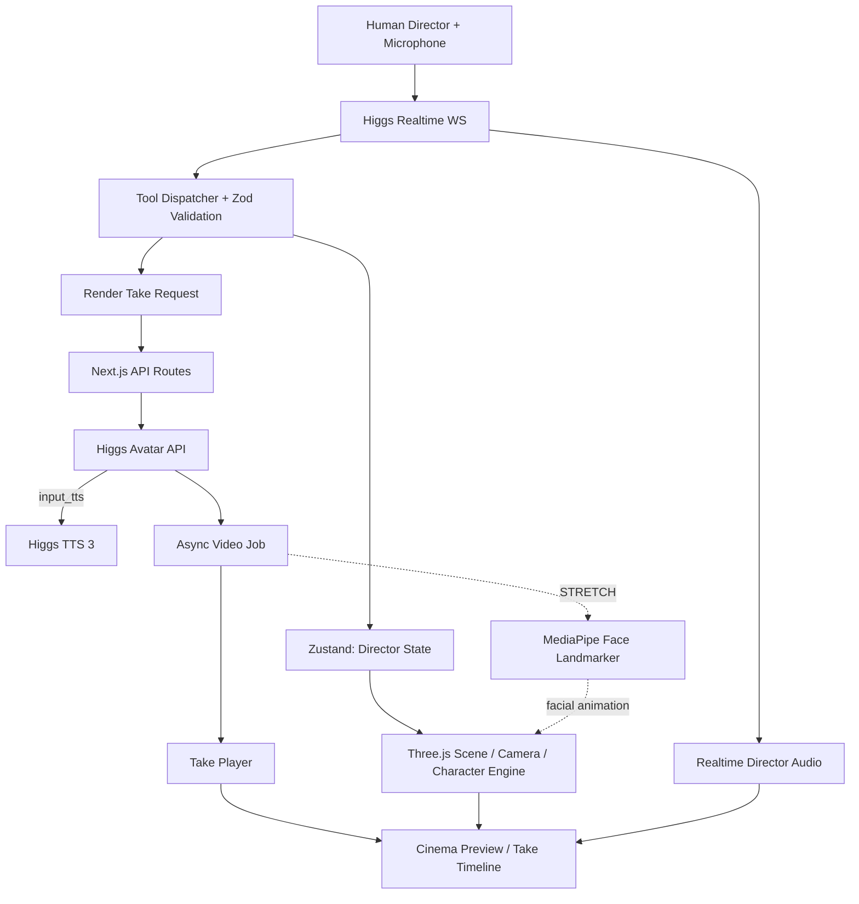

# AI Director Studio — Project Handoff

> **项目代号**：AI Director Studio / Voice-Native 3D Film Studio  
> **状态**：工程设计与交接文档（尚未实施；不是已运行项目的状态报告）  
> **版本**：v1.0 — 2026-10-23  
> **目标场景**：Boson AI Higgs Audio Hackathon 2026  
> **主线**：语音驱动 Three.js 虚拟片场 + 可编辑 3D 演员 + AI 演员语音与表演 + 非破坏性 Retake  
> **优先级**：可运行端到端 Demo > 人物可控性 > 视觉精致程度 > 通用功能范围

---

## 0. 给接手开发者 / Coding Agent 的最短指令

请先阅读本文件的 **§1、§2、§4、§5、§9、§12 和 §15**。先验证 Boson API 凭证及 Avatar 最小调用，再搭建可按钮操控的 3D 片场与角色。按下列依赖关系开发：

1. **API smoke tests**：Higgs Realtime 可连接；TTS 3 能输出可播放音频；Avatar 可生成、查询、下载一段 MP4。
2. **3D scene independent MVP**：能在浏览器中加载人物、换角色、切换衣服、修改一个确认存在的 morph、转身、挥手、运镜、调灯。
3. **Voice control**：Realtime 的工具调用能把一条用户语音转换成多个安全、有效的场景操作。
4. **Perform / Retake**：TTS 3 + Avatar 生成角色表演；每个 Take 保存状态快照并能回看。
5. **Optional**：MediaPipe 从 Avatar 视频提取 blendshapes，回放到 3D 人物。

**禁止把 §11 的 Avatar→3D facial retargeting 当作 MVP 阻塞项。** 如素材制作或云端延迟影响进度，按 §15 降级。完成各阶段后跑对应的验收测试，不要在前三阶段过度打磨 UI。

### 实现状态约定

- `[VERIFIED DOC]`：仅代表已核对官网接口文档，不代表在本环境里调用成功。
- `[TO TEST]`：需要用真实 API Key 和现场浏览器测试。
- `[DESIGN]`：本项目自定义数据结构/行为，不是 Boson 原生接口。
- `[STRETCH]`：有研究或工程风险，不纳入 MVP 验收。

---

## 1. 项目愿景与产品定位

### 1.1 一句话

**通过自然语言实时导演一个可编辑的 3D 电影片场：修改演员外貌、服装、姿态、动作、摄影机和灯光，让 AI 演员用指定情绪说台词，生成与比较不同表演版本。**

### 1.2 与普通 AI 影片生成的差别

- 普通视频生成工具：输入 prompt，等待黑盒输出视频，再整段重生成。
- 本项目：用户和 Higgs Realtime 对话，使用确定性的 3D 操作即时更改**场景状态**；只有演员声音/视频表演需要异步生成。
- 核心创新：**conversation-as-editing + non-destructive retakes**。说“保持一切不变，只把她的语气从恐惧改为愤怒”时，台词、演员、衣服、镜头和灯光都保持不变，并且能比较两个 Take。

### 1.3 目标用户与场景

- 短视频/独立创作者：快速预演机位和演员表演。
- 影视学生：学习镜头调度、构图和情绪表演。
- Hackathon 评委：2–3 分钟内看懂实时语音、工具调用、TTS 情绪控制、Avatar 角色生成的协作。

### 1.4 Demo 主场景

固定一个 **Interrogation Room（审讯室）**：一个主演员、一张桌子、两把椅子、简洁三点布光。不要允许 AI 直接生成任意新场景。剧情：嫌疑人说 “I didn't do it.”；导演调整外貌、衣服、姿态、镜头、灯光、情绪，并进行 Retake。

---

## 2. 范围、分层与技术真实性

### 2.1 MVP 必做（P0）

| 功能 | 交互示例 | 验收条件 |
|---|---|---|
| 3D 环境 | “Make the room darker.” | 灯光明显变化；界面状态一致 |
| 3D 摄影机 | “Dolly in / Orbit 30 degrees.” | 镜头平滑移动并对准人物 |
| 替换角色 | “Replace her with actor B.” / 人物特征描述 | 从预设角色库选择并加载 |
| 外形微调 | “Make the eyes larger.” | **仅**在资产中存在对应 morph 时生效；否则报 unsupported |
| 换装 | “Put on a black suit.” | 切换预制且兼容的服装或角色变体 |
| 身体动作 | “Turn right 45 degrees and wave.” | Root 旋转 + 预设 Wave 动画 |
| 实时语音 | 中文、英文指令；中途打断 | Higgs Realtime 正确调用工具 |
| 情绪语音 | “Say this line in fear / anger.” | Higgs TTS 3 参与角色音频生成 |
| 人像表演 | “Action!” | Higgs Avatar 生成能播放的 Talking-head 视频 |
| Retake | “Same line, but angry.” | 创建 Take 2，不覆盖 Take 1 |
| 错误提示 | 无此服装/动作、API 失败 | 明确报告并保持已有状态 |

### 2.2 P1（有余力）

- 角色预览的 Face/Body 两种相机；动画 cross-fade；看向摄影机的 head-look。
- TTS 3 独立 Voice Preview，满意后把**同一段**音频送给 Avatar。
- Actor reference portrait 与 3D 角色匹配；可导出角色正面截图作为新的 Avatar `ref_image`。
- Take A/B 对比、时间线和导出项目 JSON。

### 2.3 P2 / Stretch Goal（不允许阻塞 P0）

- Higgs Avatar MP4 → MediaPipe Face Landmarker → BlendShape Retargeting → 3D 面部动画。
- 3D 全景合成、同步精确音轨、复杂镜头 timeline、多个演员的自然对话。
- AI 从文字生成任意服装/人物模型、自动 rigging、动作生成、布料物理。

### 2.4 明确不做

- **Higgs Avatar 本身不会输出 3D mesh、骨骼或可编辑动画。** 它生成以静态人像为条件的 2D 说话视频。
- 语音修改鼻子等几何细节**不是文本直接生成新几何体**；它修改预制 Shape Keys 或选择其他预设。
- Three.js 没有自动“让衣服贴合任何身体”的能力；服装兼容性必须在资产阶段保证。
- 不做任意自由文本 → 任意新高质量写实角色的承诺。
- 不承诺 Avatar 无等待或实时推理；应展示“正在渲染”。

---

## 3. 三种 Boson 能力的角色分工

| 服务 | 在本项目中的用途 | 交互实时性 | 技术边界 |
|---|---|---|---|
| **Higgs Realtime** | 导演语音对话、上下文记忆、指令解释、Function Calling、打断 | 连续双向语音 | 不直接操作 GPU 场景；只产出工具调用 |
| **Higgs TTS 3** | 演员台词音色、情绪、风格、语速、暂停 | 可较快生成；独立任务 | 不维护实时对话；不输出面部骨骼 |
| **Higgs Avatar** | 给固定人像生成带口型/头动/表情的表演视频 | 异步视频任务，亦支持流式视频交付 | 非 3D 模型；不保证和场景渲染完全一致 |
| **Three.js / R3F** | 真 3D 角色、服装、动作、面部 morph、镜头、灯光 | 浏览器逐帧渲染 | 不能自动从语音生成新资产 |
| **MediaPipe（可选）** | 从 Avatar 视频推断面部运动，再映射到角色 | 后处理 / 离线或异步 | 输出估计值，不能保证 3D 形变一致性 |

**关键产品原则：**

- 语音控制角色与镜头的体验必须**立即有 3D 反馈**。
- 生成演员台词/Avatar 视频是**单独的 Render Take 操作**；编辑角色属性并不会每次都触发昂贵的视频生成。
- 播放 Avatar 特写与 Three.js 片场采用**镜头切换**而非声称一段二维视频是真正 3D 人物。
- 可以用“Actor portrait preview”的局部 2D 生成表演；从 3D 转向 Avatar 特写时采用剪辑，不展示不真实的 360° 伪三维效果。

---

## 4. 技术选型与架构

### 4.1 约定选型

- Next.js（App Router）+ React + TypeScript + Tailwind CSS
- `three` + `@react-three/fiber` + `@react-three/drei`
- MVP 角色优先 **VRM + `@pixiv/three-vrm`**；也可用结构一致的 GLB + Three.js Skeleton/SkinnedMesh
- `zustand`（权威编辑状态），`zod`（工具参数校验）
- `Higgs Realtime WebSocket`（浏览器直连，后端签发 ephemeral secret）
- Next.js Route Handlers（Boson TTS / Avatar REST 代理和后端校验）
- `@mediapipe/tasks-vision`（仅 Stretch）
- 默认不需要数据库；Take 元数据 localStorage；服务器无状态。需要持久 MP4 时再接对象存储。

### 4.2 系统架构



> Mermaid 为**逻辑概念图**。在 MVP 中，`input_tts` 是 Avatar 请求体的子对象，服务器端完成声音+视频协作；不代表我们能从中拿到独立 TTS 文件。P1 才改为显式 TTS → 音频文件 → Avatar `input`。

### 4.3 数据权威边界

- **Store 是编辑态的唯一真相来源**；Three.js 每帧从目标状态和动作指令执行渲染。
- `SceneState` 保存可持久化的**目标属性**；`CameraRig` / `AnimationMixer` 保存当前逐帧插值进度。
- 运行中的云端视频 Job 不会自动改变编辑态；Job 只更新对应 `Take`。
- Realtime 是 **intent parser/controller**；**不能直接提交任意 JavaScript、GLSL、URL 或未经验证的模型路径**。
- 所有自定义命令都必须能通过 UI 按钮单独触发，语音只是入口之一。

### 4.4 运行依赖

```bash
npx create-next-app@latest ai-director-studio --typescript --tailwind --app
cd ai-director-studio
npm install three @react-three/fiber @react-three/drei @pixiv/three-vrm zustand zod
npm install -D @types/three
# Optional only when implementing Stretch:
npm install @mediapipe/tasks-vision
```

环境文件 `.env.local`（不要提交）：

```dotenv
BOSON_API_KEY=YOUR_SERVER_SIDE_SECRET
# P0: HTTPS portrait URL reachable from Boson's servers OR an approved static sample URL.
ACTOR_REFERENCE_IMAGE_URL=https://example.org/actor-portrait.jpg
# Optional: cap local demo spending / prevent unintended render bursts.
MAX_CONCURRENT_AVATAR_JOBS=1
```

**绝不能**把 `BOSON_API_KEY` 放在 `NEXT_PUBLIC_*` 变量、前端源代码、浏览器存储或仓库里。

---

## 5. 3D 角色资产：最重要的前置条件

### 5.1 资产策略（立即决策）

- **推荐 P0：** 3 个预制人物（例如 A/B/C），至少 1 个支持若干面部 morph 的可控人物，2 个预制的同骨骼服装/角色变体。
- VRoid Studio 导出的 VRM 适合**角色加载、humanoid 动作、表情**；但“鼻子高度/脸宽”等捏脸编辑器参数**不保证导出的 VRM 会保留可直接访问的同名 Morph Targets**。
- 如果必须现场演示“鼻子更高、眼睛更大”：在 Blender 中对目标面部创建 **至少 3 个自定义 Shape Keys**，确认导出 GLB 后能用 `morphTargetDictionary` 读取；或者选择已验证有这些参数的模型。
- 服装切换：最容易的是同 rig 中服装 Mesh 显隐，或者预先导出包含同一人物不同 outfit 的模型变体。**不要现场实现通用蒙皮算法。**
- 动作：准备 Idle、Wave、Turn、Walk（可加 Sit/Point）。预先完成 Blender / Mixamo 动作重定向，并核对不同人物通用骨骼。骨骼不兼容时使用按人物打包的独立动画。

### 5.2 角色的规范层级

```text
ActorRoot                         // transform, world position, body yaw
├── Rig / Humanoid                // hips/spine/neck/head/arms/legs
├── BodyMesh                      // skinned
├── FaceMesh                      // expression morph targets
├── HairVariant_...
├── Outfit_black_suit             // compatible skinned mesh
├── Outfit_casual
└── AnimationController           // mixer, active clip, head-look override
```

### 5.3 坐标系与规范

- 使用 Three.js 默认 **Y-up**，单位约定 1 = 1 米；地面 `y=0`。
- ActorRoot 的本地“正前方”和全局右转符号要在一个函数中定义；推荐 `rotate_actor` 接收**相对角度 degrees**，以 UI 中屏幕视角和预期作为测试基准。
- 所有角色面向同一 canonical forward 方向，统一缩放、脚底落在地面、躯干原点一致。
- 角色 `actorId` 固定；换角色要保留 ActorRoot transform、镜头、灯光、台词与兼容状态；不支持的服装/morph/animation 自动清理或回退。
- 静态外貌 Morph（noseHeight、eyeSize）与动态表情 Morph（jawOpen、blink）**分开命名、分开写入**；不能互相覆盖。
- 对同一 mesh 同时存在多个 Morph 时需检视组合效果，防止夸张扭曲；对范围做 clamp。

### 5.4 资产目录和清单（项目自定义格式）

```text
public/
  assets/
    room/room.glb
    actors/actor_a.vrm
    actors/actor_b.vrm
    actors/actor_c.vrm
    portraits/actor_a_front.jpg
    portraits/actor_b_front.jpg
    portraits/actor_c_front.jpg
    animations/wave.glb
    animations/walk.glb
    animations/sit.glb
```

```ts
// lib/characters/catalog.ts  [DESIGN]
export type CharacterCapabilities = {
  morphs: Record<string, { min: number; max: number; default: number }>;
  outfits: string[];
  animations: string[];
  supportsHeadLookAt: boolean;
};

export type CharacterPreset = {
  id: string;
  displayName: string;
  descriptorTags: string[]; // e.g. visual age range, style, appearance, wardrobe
  modelPath: string;
  portraitUrl: string;       // matches actor as closely as available
  rigType: 'vrm' | 'gltf';
  capabilities: CharacterCapabilities;
};
```

**角色外貌语言：** “white man / old woman / curly-haired actor”等自然描述只用作**已有角色库查询条件**，绝不声称靠改变肤色材质就完整生成一个新身份。可先通过 `list_characters` 返回所有可选 preset 和特征标签。

### 5.5 资产验收 Checklist

- [ ] 角色加载无错误；可重复卸载、重载。
- [ ] body yaw 45°/90° 方向符合定义；骨骼不会随 Root 变形。
- [ ] 每个自定义 morph 在 `morphTargetDictionary` 中真实存在，0/1 两端变化肉眼可见。
- [ ] 服装变换后运动不会明显穿模；SkinnedMesh 跟随骨骼。
- [ ] Wave 动画能正常播放结束后回到 Idle。
- [ ] 截屏正面特写存在单个人脸且不会被头发/道具严重遮挡。
- [ ] 所有资产来源、可用许可和版权信息记录在 `ASSET_LICENSES.md`。

---

## 6. Character Engine：功能实现细节

### 6.1 模块接口（与 VRM / GLB 解耦）

```ts
// lib/characters/CharacterEngine.ts  [DESIGN]
interface CharacterEngine {
  loadPreset(actorId: string, presetId: string): Promise<void>;
  getCapabilities(actorId: string): CharacterCapabilities;
  setMorph(actorId: string, key: string, weight: number): void;
  setOutfit(actorId: string, outfitId: string): void;
  setBodyYaw(actorId: string, degrees: number, durationSec: number): void;
  setHeadLookAt(actorId: string, target: [number, number, number]): void;
  playAnimation(actorId: string, clipId: string): void;
  setExpression(actorId: string, expression: string, weight: number): void;
  capturePortrait(actorId: string): Promise<Blob>; // P1
}
```

`CharacterEngine` 是**应用层适配器**，内部针对 `vrm` 和 `gltf` 两种资产实现。UI/Realtime Dispatcher 不直接持有 Mesh 引用。

### 6.2 面部 Morph

Three.js `Mesh` 提供 `morphTargetDictionary` 和 `morphTargetInfluences`；名称以实际资产为准。

```ts
function applyNamedMorph(mesh: THREE.Mesh, key: string, weight: number) {
  const index = mesh.morphTargetDictionary?.[key];
  if (index === undefined || !mesh.morphTargetInfluences) {
    throw new Error(`Unsupported morph: ${key}`);
  }
  mesh.morphTargetInfluences[index] = THREE.MathUtils.clamp(weight, 0, 1);
}
```

对 actor 的多个 face mesh，需要在导入时建立 `morphName -> mesh/index` 映射，避免每帧 `traverse`。可支持 `set_face` 的**增量改变**（如 `delta = +0.1`）和绝对值设置，两者都要 clamp。

### 6.3 动画与分层

- `AnimationMixer` 对一个 ActorRoot 播放 Idle / Wave / Walk 等预制 clips。
- 动作切换用 `crossFadeTo()` 或 `crossFadeFrom()`；Wave `LoopOnce`，结束回 Idle。
- 第一版避免同时播放多个相互冲突的全身动画。
- `HeadLookAt` 这类程序控制，应在 `mixer.update(delta)` **之后**应用，且限制最大转头角度；需要验证不会和动画轨道冲突。
- 换人后重新绑定 mixer；不要复用旧角色的 Bone 指针。
- 可使用 Three.js `SkeletonUtils.retargetClip`，但预制兼容 clips 最可靠。

### 6.4 身体旋转/行走

- `rotate_actor` 修改 ActorRoot 的 Yaw，**不要**直接旋转头骨代替身体。
- 动画曲线采用从当前姿态到目标姿态的 Quaternion Slerp；用户新指令时立即以当前旋转作新的起点。
- 行走第一版固定短距离、固定 path，并保证不穿墙；不需要 Pathfinding AI。

### 6.5 服装/头发

- `set_outfit`: 从 capability 中检查 outfitId；支持预加载的兼容 SkinnedMesh 显隐。
- 一次只显示一套可能互斥的外装，注意 body 的隐藏几何以避免穿模。
- `set_hair`：同理替换指定 attachment Mesh，必须匹配骨骼/头部节点。
- 角色 A 的黑西装不能假设适用于角色 B；Capability 需按人物声明。

---

## 7. Three.js Camera / Lighting / Scene

### 7.1 Camera System

实现 `static`, `dolly_in`, `dolly_out`, `orbit`, `zoom` 五个明确操作即可。相机状态须有 `position`, `target`, `fov`, `durationSec`, `easing`，并保留当前 tween 进度。

- **Dolly**：改变相机位置而不直接改变焦距；始终朝向 Actor chest/head target。
- **Orbit**：绕 Actor 的中心点修改水平角，半径相对固定；保持人物构图。
- **Zoom**：保持相机位置，改变 FOV；调用 `updateProjectionMatrix()`。
- 对所有目标位置做室内 clamp，最小距离防止穿透头部/桌子。
- 如果新工具调用发生在 tween 中间，从**当前渲染状态**开始新 tween，避免相机跳回最初位置。

### 7.2 Lighting System

保持固定几个 preset：`neutral`, `dramatic`, `horror`。参数为 Spot/Point/Ambient lights 的强度、颜色、位置、颜色空间和 tone mapping，而非单纯改变背景颜色。

- 给每个 preset 做亮度和颜色渐变。
- `set_lighting` 不得使演员脸部完全不可见（保护下限）。
- Avatar 特写**不会继承** Three.js 的光照；近景风格必须用匹配的人像/后期方案解释。

### 7.3 R3F Render 架构

```tsx
<Canvas shadows camera={{ position: [0, 1.7, 4], fov: 50 }}>
  <Room />
  <LightingRig />
  <ActorGroup />
  <CameraRig />
</Canvas>
```

R3F 的 `useFrame` 只管理动画/插值；React 的 scene state 改变由 Zustand 触发。避免每帧 `setState()` 导致整个 React 树重新渲染。

---

## 8. Director State、Take 数据结构与一致性

### 8.1 数据模型（基线）

```ts
// types/director.ts  [DESIGN]
type Vec3 = [number, number, number];

type ActorState = {
  actorId: string;
  presetId: string;
  position: Vec3;
  yawDeg: number;
  outfitId: string;
  hairId?: string;
  staticMorphs: Record<string, number>;
  expression: string;
  animation: string;
  dialogue: string;
  emotion: 'neutral' | 'fear' | 'anger';
  style: 'normal' | 'whispering' | 'shouting';
  voice: string;
};

type SceneState = {
  sceneId: 'interrogation';
  lightingPreset: 'neutral' | 'dramatic' | 'horror';
  camera: {
    shot: 'wide' | 'medium' | 'closeup';
    movement: 'static' | 'dolly_in' | 'dolly_out' | 'orbit' | 'zoom';
    durationSec: number;
    angleDeg?: number;
    fov: number;
    position: Vec3;
    target: Vec3;
  };
  actors: Record<string, ActorState>;
  revision: number;
};

type Take = {
  takeId: string;
  createdAt: number;
  sceneRevision: number;
  snapshot: SceneState;
  referenceImageId?: string;
  videoId?: string;
  status: 'draft'|'queued'|'in_progress'|'completed'|'failed';
  error?: string;
  localVideoUrl?: string;
};

type ProjectState = {
  scene: SceneState;
  takes: Record<string, Take>;
  selectedTakeId?: string;
  playbackMode: 'scene' | 'avatar' | 'comparison';
};
```

### 8.2 非破坏性更新

- “Keep everything else, change anger” 只 patch 对应 actor 的 `emotion`，然后 `scene.revision++`。
- `render_take` **先拷贝快照，再提交异步请求**；回包必须按 `takeId` 更新。
- 用户取消播放或切换选中的 Take 时，不得改写云端 job 的内容或覆盖另一个 Take。
- Take 不能引用会继续发生变化的状态对象：需要 deep clone（如 `structuredClone(scene)`，前提是仅含可序列化数据）。
- 浏览器重启后如只有 `videoId`，尝试重新查询状态；没有长期存储保障，不承诺永久可重放。

### 8.3 Undo / Redo（P1）

每次有效工具变更前保存 SceneState 快照到有限长度的历史栈（例如最后 20 次操作），不要把 Three.js Mesh/Texture 放进历史。创建 Take 仍为独立事件。

---

## 9. Higgs Realtime：连接、工具和 Dispatcher

### 9.1 真实 API 事实 [VERIFIED DOC]

- WebSocket：`wss://api.boson.ai/v1/realtime`。
- 浏览器安全连接：后端 `POST https://api.boson.ai/v1/realtime/client_secrets` 创建 ephemeral secret，然后浏览器使用 `new WebSocket(url, ['realtime', 'bai-client-secret.' + token])`。
- `session.update` 可设置 `model: 'higgs-realtime'`、`tools`、`instructions` 和 `audio.input.turn_detection`。
- `response.done` 可携带客户端需要执行的 `function_call` 输出；调用后通过 `conversation.item.create` 发送 `function_call_output`（对应原 `call_id`），然后 `response.create` 继续对话。
- `input_audio_buffer.speech_started` 是打断信号；需要同时停止本地正在播放的导演音频及 Avatar 视频。
- Session 默认语音可用；输入转写可按需启用 `higgs-stt-3.1`（与实时理解本身分离）。

### 9.2 后端签发 token（示意代码）

```ts
// app/api/realtime/token/route.ts — server only
export async function POST() {
  const upstream = await fetch(
    'https://api.boson.ai/v1/realtime/client_secrets',
    {
      method: 'POST',
      headers: {
        Authorization: `Bearer ${process.env.BOSON_API_KEY}`,
        'Content-Type': 'application/json',
      },
      body: JSON.stringify({ expires_after: { seconds: 600 } }),
      cache: 'no-store',
    }
  );
  if (!upstream.ok) {
    return Response.json({ error: 'token_unavailable' }, { status: 502 });
  }
  const data = await upstream.json();
  return Response.json({ value: data.value, expires_at: data.expires_at });
}
```

部署到公网时给该 API 增加鉴权/Rate Limit 和调用额度保护，避免匿名刷 API credits。

### 9.3 工具清单（应用设计，而非官方函数名）

| Tool | 必要参数 | 读/写 | 错误返回 |
|---|---|---|---|
| `list_characters` | 无 | 读 catalog | catalog_unavailable |
| `get_scene_state` | 无 | 读 store | 视情况 |
| `replace_actor` | actorId, presetId | 写角色 | preset_not_found |
| `set_face` | actorId, morph, value 或 delta | 写 Morph | unsupported_morph |
| `set_outfit` | actorId, outfitId | 写服装 | unsupported_outfit |
| `rotate_actor` | actorId, degrees, durationSec | 写旋转 | invalid_angle |
| `play_animation` | actorId, animationId | 写动作 | unsupported_animation |
| `set_camera` | movement, shot, durationSec, angleDeg? | 写摄影机 | invalid_camera_move |
| `set_lighting` | preset | 写灯光 | unsupported_preset |
| `set_performance` | actorId, dialogue?, emotion?, style?, voice? | 写表演参数 | invalid_text_or_voice |
| `render_take` | actorId | 创建异步 Job | render_quota_or_upstream_failure |

**首次集成可只暴露 5 个关键工具：** `replace_actor`, `set_outfit`, `rotate_actor`, `set_camera`, `set_performance`；待 Realtime 稳定后添加剩余工具。最终 demo 需包含 face morph、action 和 render。

### 9.4 Zod 校验示例

```ts
import { z } from 'zod';

export const SetFaceArgs = z.object({
  actorId: z.string().min(1),
  morph: z.string().min(1),
  value: z.number().min(0).max(1),
});

export const RotateActorArgs = z.object({
  actorId: z.string().min(1),
  degrees: z.number().finite().min(-360).max(360),
  durationSec: z.number().min(0).max(10).default(1),
});
```

`getCapabilities(actorId)` 必须在参数形状检查后执行；即使 schema 通过，也不能保证角色支持该 morph。Tool result 返回 `{"ok":false,"error":"unsupported_morph","available":[...]}`。

### 9.5 工具执行协议与幂等性

1. 收到已完成的 `function_call`（按 `call_id`）后，先校验 JSON 和白名单。
2. 按场景工具、云端 Render Tool 分类：本地场景修改可立即执行；Render Tool 先创建记录并返回 `takeId`，不阻塞语音会话等待视频完成。
3. 同一个 `call_id` 必须最多执行一次：记录执行结果并在重复回调时原样返回。
4. 每次执行完通过 `function_call_output` 返回 `ok / stateRevision / takeId / error`。
5. 工具调用含多个步骤时按调用顺序执行；对失败步骤做部分失败报告，避免声称所有步骤已完成。多个 function calls 的 event 时序按官方 SDK/测试确认后实现。
6. 返回工具结果后再请求 Realtime 继续回应。**不要**在 Render Job 未完成时声称“视频已经准备好”。

### 9.6 System prompt（初稿）

```text
You are the AI Director Assistant inside a live 3D film studio.
The user's voice directs a real 3D scene through provided tools.

Rules:
- Use tools for actual scene changes; never claim success before tool results.
- Prefer bounded, deterministic changes to characters, face morphs, outfits,
  animations, camera, and lights. Never propose arbitrary source-code execution.
- The actor catalog and capability lists are ground truth. If a requested
  feature is unavailable, suggest supported alternatives.
- Preserve every unspecified scene and performance attribute.
- "Action" or an explicit render request invokes render_take.
- "Cut" stops playback; do not assert that remote cloud jobs were cancelled.
- A render_take returns a job/take id, not an instant MP4.
- Keep spoken feedback short, conversational, and interruptible.
- Understand instructions in Chinese and English.
- A replacement actor must also validate outfit, morph, and animation state.
- Do not speak the full acting line yourself; TTS 3 creates actor delivery.
```

### 9.7 打断与播放冲突

- 应用维护一个 `PlaybackController`：Director Realtime audio、Actor video/audio 两个通道。
- 在 `input_audio_buffer.speech_started`：暂停 Actor 视频，清理未播放的本地 Realtime 音频队列；按官方协议允许对话打断，保留用户编辑能力。
- 不要让麦克风持续录到正在播放的 Actor 声音造成循环；现场优先耳机。可提供 Push-to-Talk / mute 控件作为后备。
- Avatar video 暂停不等于远端 job 被取消；不要假设有取消 API。
- 浏览器音频应在首次用户交互后初始化，处理 autoplay 限制。

---

## 10. Higgs TTS 3 + Higgs Avatar 集成

### 10.1 官方接口 [VERIFIED DOC]

- TTS 3：`POST https://api.boson.ai/v1/audio/speech`；`model: 'higgs-tts-3'`。
- Avatar：`POST https://api.boson.ai/v1/videos`；`model: 'higgs-avatar'`。
- Avatar 正常完整视频流程：`POST /v1/videos` → `GET /v1/videos/{id}`（`queued` / `in_progress` / `completed` / `failed`）→ `GET /v1/videos/{id}/content`。
- Avatar 必须给 `ref_image`，且只传 **`input` 或 `input_tts` 二选一**。
- `input_tts` 可以内嵌 `model: 'higgs-tts-3'` 的 TTS 请求。
- Avatar 输出尺寸文档列出 `640x640`, `640x480`, `480x640`；TTS 文字上限 5000 字符；已有音频时 `input` 上限 60 秒。MVP 限台词 1–2 句。
- `POST /v1/videos/stream` 支持 fMP4 渐进交付，但**不意味着视频无生成延迟**。先用异步 MP4 保证可靠性。

### 10.2 MVP 简化路径：Avatar 内置 TTS 3

```ts
// lib/boson/submitAvatarTake.ts — server only, demonstration
async function submitAvatarTake(input: {
  portraitUrl: string;
  text: string;
  emotion: 'neutral' | 'fear' | 'anger';
  style: 'normal' | 'whispering' | 'shouting';
  voice: string;
}) {
  const emotions = {
    neutral: '',
    fear: '<|emotion:fear|>',
    anger: '<|emotion:anger|>',
  };
  const styles = {
    normal: '',
    whispering: '<|style:whispering|>',
    shouting: '<|style:shouting|>',
  };
  const text = `${emotions[input.emotion]}${styles[input.style]}${input.text}`;
  const response = await fetch('https://api.boson.ai/v1/videos', {
    method: 'POST',
    headers: {
      Authorization: `Bearer ${process.env.BOSON_API_KEY}`,
      'Content-Type': 'application/json',
    },
    body: JSON.stringify({
      model: 'higgs-avatar',
      ref_image: input.portraitUrl,
      input_tts: { model: 'higgs-tts-3', voice: input.voice, input: text },
      size: '640x640',
    }),
  });
  if (!response.ok) throw new Error(`Avatar API: ${response.status} ${await response.text()}`);
  const body = await response.json();
  return { videoId: body.id, status: body.status };
}
```

此路径确实调用 TTS 3（通过 Avatar 内置 `input_tts`），满足三个能力参与闭环；但 **TTS/Avatar 音频无法作为独立本地音频对象精确控制**。如果要做 3D 脸部动画及精确同步，应升级为下一条路径。

### 10.3 P1 独立声音路径（推荐 3D Face Retargeting 前置）

1. 后端 `POST /v1/audio/speech`，输入带情绪 tag 的文本，取得音频 bytes。
2. 为该 Take 保存对应音频文件（临时缓存或对象存储），使 `audioUrl` 与 `takeId` 绑定。
3. 把**同一个音频**作为 Avatar 的 `input`（上传二进制 multipart 或用 HTTPS URL），同时 `ref_image` 固定。
4. Avatar 生成视频后，播放时以 **单一媒体时钟**驱动 Three.js 面部动画。不要分别播放 MP3 和含同一声音的 MP4 造成双音轨。

### 10.4 情绪标签映射

| UI Emotion/Style | 建议 TTS Tag |
|---|---|
| fear | `<|emotion:fear|>` |
| anger | `<|emotion:anger|>` |
| neutral | 不填 tag 或 `<|reset|>` |
| whispering | `<|style:whispering|>` |
| shouting | `<|style:shouting|>` |
| slow | `<|prosody:speed_slow|>` |
| pause | `<|prosody:pause|>` 插在目标停顿处 |

标签由后端的**白名单映射函数**生成，不接受未经验证的自定义标签。为避免前后端失配，voice preset 也从已验证选项中选择。

### 10.5 Avatar 参考人像与 3D 角色一致性

这是产品最容易被误解的地方：

1. **P0 推荐**：为每个预制 3D 角色准备一张与其外观、发型、服装相匹配的 frontal portrait。切换人物同时切换对应 `ref_image`。
2. 如果用户调了鼻子、发型或衣服而 portrait 没更新，那么 **Avatar 特写不会自动反映这次 3D 修改**。界面需要注明“Avatar portrait is based on preset; custom edits may differ”，或者在此类修改后提示“update portrait”。
3. **P1 补救**：使用 Three.js **独立正面离屏摄像机**捕获最新角色上半身高清图，上传到服务端，然后以 multipart `ref_image` 送 Avatar。确保单一人物、正面、光照均匀、没有挡脸、`readRenderTargetPixels` 或合法 canvas 截图；输入图质量决定结果质量。
4. Avatar 对风格化/渲染式人像的效果、衣服/脸部细节保持程度**必须实测**；即使截图准确，视频生成也不保证所有几何细节完全一致。
5. 若截图效果差，回退到官方例图或预制人像，明确区分“3D 角色编辑”和“2D Avatar 演出”。

### 10.6 Next.js API endpoints

| Endpoint | 方法 | 职责 | 注意事项 |
|---|---|---|---|
| `/api/realtime/token` | POST | 创建 Realtime ephemeral token | 不能泄露长效 Key |
| `/api/takes` | POST | 验证输入，锁定 Snapshot，向 Boson 创建视频 | 服务端状态/限流 |
| `/api/takes/[videoId]` | GET | 查询 Avatar status/error | ID 校验；禁止任意 URL |
| `/api/takes/[videoId]/video` | GET | 代理完成的 MP4 | 避免大文件重复下载；Range/CORS 后续再优化 |
| `/api/tts/preview` | POST（P1） | 生成可试听的 TTS 3 音频 | Rate Limit / Binary streaming |
| `/api/assets/portrait` | POST（P1） | 接收经过验证的 PNG/JPEG 人像 | 校验 MIME/尺寸/大小，禁止未授权读写 |

### 10.7 Render Take lifecycle

```mermaid
sequenceDiagram
    participant User
    participant UI
    participant Server
    participant Boson
    User->>UI: "Action! Say it in fear"
    UI->>UI: Snapshot state; create Take[queued]
    UI->>Server: POST /api/takes
    Server->>Boson: POST /v1/videos with input_tts
    Boson-->>Server: video_id
    Server-->>UI: takeId, videoId
    UI->>UI: Take[in_progress] + progress UI
    loop Poll with backoff
      UI->>Server: GET /api/takes/{videoId}
      Server->>Boson: GET /v1/videos/{videoId}
      Boson-->>UI: status (via Server)
    end
    UI->>Server: GET /api/takes/{videoId}/video
    Server->>Boson: GET /v1/videos/{videoId}/content
    Server-->>UI: MP4
    UI->>User: Play Take / Compare Versions
```

> 若 `queued/in_progress` 较久，应显示真实状态与可重试入口。**不要伪造百分比**。处理 `failed`、429、超时、丢失连接；上游失败不要自动无限重试生成并消耗额度。

---

## 11. [STRETCH] Avatar → MediaPipe → 真实 3D 面部表演

### 11.1 技术目标

让 3D 人物保持完整的可操作 mesh/skeleton：播放台词时，口型、眼睛、眉毛等变化**来自 Avatar 生成视频的面部运动估计**，身体仍可旋转、挥手或运镜。

### 11.2 实现流水线

```text
(3D Actor frontal portrait / matching preset image)
            +
       (TTS 3 audio)
            |
            v
      Higgs Avatar MP4
            |
            v
    Extract / decode frames
            |
            v
 MediaPipe Face Landmarker (VIDEO mode, outputFaceBlendshapes = true)
            |
            v
  [{tSec, expressionCoefficients, optionalHeadPose}]
            |
            v
  Name remap + calibration + smoothing + clamping
            |
            v
  3D Character morphTarget / VRM ExpressionManager
            |
            v
        Synchronize playback
```

### 11.3 关键事实与限制

- MediaPipe Face Landmarker 在浏览器能输出约 52 个表情 blendshape 系数及面部变换矩阵（开启相应选项）。
- 它输出的是**视频图像的估计表情**，不是原始 Avatar 内部参数；严重遮挡、表情夸张、光照变化会降低稳定性。
- 有 Face Landmarker 的 52 个系数 **≠** 3D 角色有 52 个兼容 Shape Keys。必须建立显式映射表，并容忍缺失参数。
- 某些操作（如鼻梁高度）属于静态身份形状，不应从动态表情系数中反复覆盖。
- 视频解码和逐帧推断可能阻塞主线程，建议 worker / 后台预处理；简单 Demo 可只分析短片段并缓存 JSON。
- 播放时优先用视频 `currentTime` 当主时间轴，插值采样最近两帧系数。若显示 3D 回放，可以保持视频元素隐藏但**不能重复播放音频**。
- 对偏航头部姿态采用限制角度的 retargeting，不要直接把 2D face pose 无约束映射到全身 Root。

### 11.4 数据格式（示例）

```json
{
  "takeId": "take_002",
  "fps": 25,
  "frames": [
    {"t": 0.00, "jawOpen": 0.08, "eyeBlinkLeft": 0.0, "browInnerUp": 0.2},
    {"t": 0.04, "jawOpen": 0.33, "eyeBlinkLeft": 0.0, "browInnerUp": 0.27}
  ]
}
```

### 11.5 最小实验验收标准

- [ ] 从 1 段 3–6 秒短视频成功提取系数并保存 JSON。
- [ ] 3D 角色至少 `jawOpen`, `eyeBlinkLeft/Right`, `browInnerUp` 中的 2–4 个参数可映射、能看出明显变化。
- [ ] 从播放到暂停、拖动时间轴，表情跟随媒体时间改变。
- [ ] 30 秒以内短片段无明显音画脱节；如不达标则**不展示该 Stretch**。
- [ ] 人物能够转动 Root，而该面部动画仍稳定播放。

**停损规则**：如 API 视频生成延迟、解码耗时、Morph 资产兼容性任何一个问题影响 P0 演示，则先禁用本功能，不做临时复杂补丁。

---

## 12. 前端页面与交互设计

建议三栏布局（窄屏折叠）：

**左侧 3D/主窗口**
- Three.js Cinematic Preview（可切换 Scene / Avatar Video）
- 当前演员高亮、摄像机视角、灯光状态
- 首次麦克风授权入口；Mute / Push-to-talk / Interrupt 按钮

**右侧 Inspector**
- Cast：预设人物列表、服装、头发、Morph sliders
- Body：Yaw slider、Idle/Wave/Walk 动画按钮
- Camera：Shot/Movement/Duration；Light：Preset
- Performance：Dialogue、Emotion、Voice、Render Take

**底部 Timeline**
- 最近 3–6 个 Takes 的 thumbnail、状态、预览
- A/B 对比（点击即可切换原/新版本）
- 可查看 Edit Log：如 `set_face(noseHeight +0.2)`，增强透明度

**交互原则**
- 每个语音动作都要在 Inspector 反映出来；每个按钮也必须更新 Store。
- 操作不可用时禁用并解释为什么（如当前模型没有 noseHeight Morph）。
- 生成中的 Take 是非阻塞卡片；不锁住全页面。
- Avatar 特写、3D 人物渲染不同步时，要清晰标注“Video Take” vs “Live 3D Scene”。

---

## 13. 目录结构与分工建议

```text
ai-director-studio/
├── app/
│   ├── page.tsx
│   ├── layout.tsx
│   └── api/
│       ├── realtime/token/route.ts
│       ├── takes/route.ts
│       ├── takes/[videoId]/route.ts
│       ├── takes/[videoId]/video/route.ts
│       └── tts/preview/route.ts                # P1
├── components/
│   ├── scene/
│   │   ├── SceneCanvas.tsx
│   │   ├── InterrogationRoom.tsx
│   │   ├── LightingRig.tsx
│   │   ├── CameraRig.tsx
│   │   └── ActorRenderer.tsx
│   ├── character/
│   │   ├── CharacterInspector.tsx
│   │   └── CastPicker.tsx
│   ├── voice/
│   │   ├── VoiceDirector.tsx
│   │   └── PlaybackController.tsx
│   ├── takes/
│   │   ├── TakeTimeline.tsx
│   │   └── TakePlayer.tsx
│   └── ui/
├── lib/
│   ├── characters/
│   │   ├── catalog.ts
│   │   ├── CharacterEngine.ts
│   │   ├── VRMCharacterAdapter.ts
│   │   └── GLTFCharacterAdapter.ts
│   ├── camera/CameraPlanner.ts
│   ├── lighting/presets.ts
│   ├── realtime/
│   │   ├── client.ts
│   │   ├── toolSchemas.ts
│   │   ├── toolDispatcher.ts
│   │   └── systemPrompt.ts
│   ├── boson/
│   │   ├── avatar.ts
│   │   └── tts.ts
│   └── facial/
│       ├── extractBlendshapes.ts              # Stretch
│       └── retargetBlendshapes.ts             # Stretch
├── store/directorStore.ts
├── types/director.ts
├── public/assets/
│   ├── room/
│   ├── actors/
│   ├── portraits/
│   └── animations/
├── tests/
│   ├── cameraPlanner.test.ts
│   ├── toolDispatcher.test.ts
│   ├── characterCapabilities.test.ts
│   └── takeRevision.test.ts
├── scripts/
│   ├── verify-assets.ts
│   └── boson-smoke-test.ts
├── ASSET_LICENSES.md
├── README.md
└── .env.example
```

### 并行开发（两到三人）

- **A：3D / Assets**：角色导入、rig、morph、outfit、animation、CameraRig、LightingRig。
- **B：Voice / Boson**：Realtime WebSocket、Tool Dispatcher、TTS/Avatar REST、Take 状态机。
- **C：UI / Integration（若有）**：Inspector、Take Timeline、播放器、错误处理、Demo 脚本。
- 提前达成接口冻结：`SceneState`、`CharacterCapabilities`、工具参数以及 Take status。不允许各模块自己发明不同 ID 或属性名。

---

## 14. 质量目标、测试与观测性

### 14.1 功能测试（可用 Playwright/手工结合）

| 测试 ID | 操作 | 预期 |
|---|---|---|
| CHAR-01 | 从 actor A 切到 B | 新人物加载；镜头/灯光保留；不兼容 outfit reset |
| CHAR-02 | 为没有 `noseHeight` 的人物调鼻子 | 返回 unsupported，状态不变 |
| CHAR-03 | 切换 BlackSuit 然后 Wave | 服装可见且跟随骨骼，无严重穿模 |
| CHAR-04 | Body rotate +90，期间再 rotate -30 | 平滑从当前角度到新目标，无跳变 |
| CAM-01 | Dolly in 时中途 Orbit | 相机从当前位置继续，不瞬移 |
| FACE-01 | 将 eyeSize 从 0 → 1 | 实际形变可见；不覆盖 smile/jawOpen |
| VOICE-01 | “Turn right 45 degrees and wave” | 对应的两个工具都执行且有结果 |
| VOICE-02 | 不存在的动作 | 模型报告不能执行，不谎称成功 |
| VOICE-03 | 正在播报时用户插话 | 停止本地音频/视频并接收新指令 |
| TAKE-01 | 两个不同 emotion 的生成任务交叉完成 | 结果保存在各自 Take；不覆盖当前选择 |
| TAKE-02 | Avatar job failed / rate-limited | 显示可恢复错误；SceneState 不损坏 |
| TAKE-03 | 同一 function call ID 重复触发 | 工具只执行一次 |
| SEC-01 | 浏览器开发工具检查 | 不存在长效 Boson API Key |
| PERF-01 | 3D 页面操作 3 分钟 | 未观察到严重的帧率退化/明显内存泄漏 |

### 14.2 建议性能/可用性目标（设计目标，非已实测）

- 场景属性变化：UI 在收到工具执行结果后即时更新；本地动画目标建议数百毫秒内开始。
- 3D 渲染：普通笔记本 Chrome 浏览器期望 30 FPS 以上；测试设备与 WebGL 限制必须记录。
- Realtime：有可见的“Listening / Thinking / Executing”状态；工具耗时的真实统计记录。
- Avatar：记录真实 `submittedAt`, `completedAt`, `failedAt`，绝不向用户展示编造的 ETA。
- Demo 网络不稳定时：仍能使用按钮操作 3D 场景并回放已合法预生成的示例 Take；必须明确标记“cached demo sample”。

### 14.3 日志（不记录密钥）

建议结构化日志字段：`timestamp`, `sessionId`, `callId`, `toolName`, `durationMs`, `sceneRevision`, `takeId`, `videoId`, `result`, `errorCode`。未经用户同意不要保存原始麦克风录音或真人肖像。

---

## 15. 分阶段执行计划、完成定义与停损门槛

> 以下时间为单次 Hackathon 粗估，**不是交付时间承诺**。按依赖关系调整，不应把并行工时相加当作实际墙钟时间。

### Phase 0 — External API Gate（0.5–1.5h）

任务：
- [ ] 拿到 Boson API Key，确认 credits/额度。
- [ ] 官方例图 + `input_tts` 创建 1 个 Avatar job，轮询到 `completed`，拿到 MP4。
- [ ] 单独 TTS 3 生成一个带 `emotion:fear` 的 MP3。
- [ ] Realtime 建立 WS，并收到可用语音回包。

**DoD**：三项服务都有真实 API smoke-test 成功记录。**若 Avatar 阻塞，3D/Realtime 并行继续，提交“Avatar integration incomplete”风险项。**

### Phase 1 — Editable 3D Stage（2–4h）

任务：
- [ ] 审讯室、镜头、灯光可独立运行。
- [ ] 至少 2 个 3D 人物；至少 1 个有实际 Morph；至少 1 次服装切换；至少 1 个动作。
- [ ] Inspector 按钮能触发上述操作。

**DoD**：完全关掉 Boson API 后，仍可通过按钮完成角色与镜头编辑。

### Phase 2 — Voice Director（2–3h）

任务：
- [ ] Browser ephemeral secret；麦克风/扬声器通道。
- [ ] Function tools + Zod + Capability Discovery。
- [ ] 单句话执行至少 2 个场景操作。
- [ ] 插话停止旧语音，场景仍保持可继续编辑。

**DoD**：语音“换演员、黑西装、右转 45 度、挥手”成功触发相应可用操作；不支持时可靠拒绝。

### Phase 3 — Performance & Retake（2–4h）

任务：
- [ ] `set_performance` 保存台词/voice/emotion。
- [ ] `render_take` 创建异步视频任务，轮询，播放。
- [ ] Take Snapshot / Revision；“same line but angry”生成 Take 2。
- [ ] 防止旧任务覆盖新版本；失败/超时提示。

**DoD**：演示至少两段不同情绪的 Higgs TTS 3 + Avatar 演出，同时 3D 场景可继续修改。

### Phase 4 — Demo Hardening（2–3h）

任务：
- [ ] 逐项测试 §14，修复严重 Bug。
- [ ] 准备备用已生成 Take、3D 场景缓存、备用按钮路径。
- [ ] UI 显示微型 Tool Log / Take timeline / real job status。
- [ ] 录一份屏幕演示备份、README、仓库链接、提交说明。

**DoD**：从进入页面到 A/B Retake，至少能稳定演示一整次；中间出错能被清楚解释/降级。

### Phase 5 — Facial Retargeting（仅余时足够）

- [ ] 单段 Avatar 视频 → MediaPipe → JSON → 3D `jawOpen`。
- [ ] 如果效果良好再加 Blink/Brow、Media Clock Sync。

**DoD**：3D 演员真实表情随 Avatar 视频变化，可绕人运镜；若达不到，保留为 Roadmap，不进入主 Demo。

### 停损 / 降级矩阵

| 卡点 | 立即降级方式 |
|---|---|
| 角色 Morph 无法导出 | 演示已经验证过的表情 BlendShape，禁止假装能改鼻梁 |
| 不同衣服发生严重穿模 | 改为完整 Actor+Outfit preset 切换 |
| 动画 retargeting 错误 | 仅使用同 rig 的 Wave/Idle |
| Realtime Function Calling 不稳定 | 提供可点的工具按钮和 transcript debug；演示 voice 的已稳定指令 |
| Avatar 生成时间超出 Demo | 展示 queued/job 与以前真实生成的 cached Take，标注缓存 |
| 生成的人像与 3D 角色严重不一致 | 固定对应角色人像，展示“Live 3D / Actor Close-Up”两种模式 |
| Face Retargeting 性能差 | 禁用 Stretch，播放原 MP4 |
| 浏览器设备太慢 | 关阴影/降分辨率/缩减网格和后处理 |

---

## 16. 演示脚本（2–3 分钟，可调整）

| 时间点（建议） | 用户说的话 / 操作 | 观众看到 | 核心能力 |
|---|---|---|---|
| 00:00 | “Welcome to my interrogation room.” | Three.js 片场和角色 | 3D stage |
| 00:15 | “Replace the actor with [preset description].” | 角色从 A → B | Realtime + Character Catalog |
| 00:35 | “Give him a black suit, turn him 45 degrees, and wave.” | 服装切换+旋转+动作 | 多工具调用 |
| 00:55 | “Make his eyes a bit wider. Dolly in and turn the lighting dramatic.” | Face morph + 镜头 + 灯光 | morph + camera + light |
| 01:20 | “Have him say ‘I didn't do it’ in a frightened whisper. Action!” | TTS/Avatar 生成 Job 出现 | Realtime + TTS 3 + Avatar |
| 01:35 | **若云端已完成**，播放 Take 1；否则看已完成真实缓存 Take 1 | 人像表演特写 | Avatar playback |
| 01:55 | “Cut! Same line, but angry. Retake.” | SceneState 保留，其余不变；生成 Take 2 | State snapshot + Retake |
| 02:20 | 对比 Take 1/2（或显示等待中的 Take 2 + 缓存） | 两版情绪可听见差异 | AI acting + persistence |
| 02:35 | （Optional）播放 3D facial retarget demo | 真实 3D 口型与转身 | MediaPipe Stretch |

**一句话 Pitch：**  
> “We turned filmmaking into a conversation: live 3D staging responds instantly to your voice, while Higgs gives editable characters expressive performances you can retake without rebuilding your scene.”

**评委可能追问**：

- “Why all three models?” → Realtime controls, TTS 3 acts, Avatar visualizes expression/lip sync.
- “Is the Avatar 3D?” → No; the 3D character is rendered by Three.js. Avatar is the filmed close-up; optional MediaPipe retargeting reconstructs estimated expression curves for the 3D rig.
- “What changes are truly editable?” → Actor preset, supported morphs, outfit variant, root/head pose, canned animation, camera, lighting, dialogue/voice/emotion.
- “Can you edit any face?” → Only if rigged morph targets are present; otherwise choose a preset or preprocess in Blender.
- “What if generation is slow?” → 3D editing remains interactive; asynchronous job shown honestly and cached completed Takes can be replayed.

---

## 17. 开发入口、交付与交接检查

### 17.1 第一个可执行任务

1. 建 Next.js 空项目，安装 §4 中的依赖。
2. 写 `scripts/boson-smoke-test.ts` 或最简单的 curl：分别验证 TTS、Avatar，以及 Realtime token/WS。
3. 找一份**可编辑且许可允许演示**的角色：读取其 `morphTargetDictionary`、AnimationClips、outfits。
4. 按 §13 组织目录，先实现 `SceneCanvas.tsx` + Inspector buttons。
5. 截图/录屏记录加载的 asset 与跑通的 API 请求结果；在 README 中标记 `[DONE] / [BLOCKED]`。

### 17.2 README 交付要包括

- 一句话简介、Repo/Live Demo URL、操作步骤、Demo 视频
- 本地启动命令、环境变量 `.env.example`、API credits 前置条件
- 已支持的人物外观/服装/动作和不支持的命令清单
- 模型各自负责的能力、真实异步/缓存标记
- 已知局限、资产授权、Hackathon 贡献者
- Smoke test / E2E test 如何运行

### 17.3 交接状态表（初始状态）

| 项目 | 当前状态 |
|---|---|
| 产品需求、技术架构、数据模型 | **设计完成（本文件）** |
| Next.js 项目实际代码 | **未创建** |
| Three.js 场景和角色资产 | **未接入、未验收** |
| Higgs Realtime API 实测 | **未执行** |
| Higgs TTS 3 API 实测 | **未执行** |
| Higgs Avatar API 实测 | **未执行** |
| Voice Tool Calling 实测 | **未执行** |
| Retake UI / Take Persistence | **未实现** |
| Avatar→3D 面部迁移 | **可选研究项** |
| 浏览器 E2E / 性能测试 | **未执行** |

**务必更新此表再交给下一名开发者；不要把文档里的示意代码当作已测试、可直接投产的模块。**

---

## 18. 安全、隐私、授权与成本

- API Key 仅在 Next.js server runtime 使用；禁止日志输出；异常消息对前端脱敏。
- 浏览器 Realtime 必须用 ephemeral secret；限制 token 签发频率；公开 Demo 增加认证/简单门禁、配额和并发控制。
- `videoId`/资产 ID 做长度、字符集验证；不允许用户提交任意内部 URL 或通过后端 proxy 请求任意第三方站点（SSRF）。
- 出于安全和成本，`render_take` 每次显式触发；设置单用户并发上限（P0 建议 1），防抖并防重复 callId。
- 用户上传真人脸照或声音用于 Avatar/Cloning：必须有使用授权/知情同意；建议 Hackathon 只使用自制或获准的素材与公开预设 voice。
- 资产使用条款必须符合演示、托管与仓库分发方式，尤其不要直接公开未授权 raw character / animation files。
- 若项目涉及各类人物外貌描述，将其用作已有角色检索标签；不要推断用户个人敏感属性。
- Avatar 视频可能包含合成形象与声音；在界面/README 中明确为 AI-generated performance。
- API 生成可能消费 credit；事先验证使用额度、缓存样本、成本上限。不要在失败时无限循环提交新渲染。

---

## 19. 当前待确定事项（不应阻塞代码起步）

1. **角色来源**：VRM 风格化人物优先，还是带自定义 morph 的写实 GLB？
   - 默认：优先能快速验证骨骼/自定义 morph 的角色，**不强求写实**。
2. **外貌编辑深度**：只需 preset+眼睛/鼻子/下巴 3 个形变，还是希望自由捏脸？
   - 默认：3 个事先验证的 morph；无法做到则减少为 1 个真实 morph。
3. **服装**：同一人物多套衣服，还是不同 Actor+Outfit 预设组合？
   - 默认：采用能稳定显示且没有穿模的方案，不为“动态换装技术”牺牲 Demo。
4. **Avatar 参考图**：预制匹配人像 or Three.js 导出正面截图？
   - 默认：预制匹配人像用于 P0；截图作为 P1。若需要实时反映面部自定义，必须尽早验证截图效果。
5. **表演呈现**：切到 2D Avatar 特写 or 在 3D 监视器播放？
   - 默认：切到特写；片场保留独立 Preview，说明它们属于不同渲染途径。
6. **是否投入 Avatar→3D face retargeting**？
   - 默认：只有所有 P0 验收完成且还有时间才做。

---

## 20. 官方参考资料（已于 2026-10-23 查阅；实施前检查最新版本）

### Boson

- Hackathon 要求：https://www.boson.ai/hackathon
- Higgs Realtime overview：https://docs.boson.ai/models/higgs-realtime/overview
- Realtime sessions / client secret：https://docs.boson.ai/models/higgs-realtime/guides/connections-and-sessions
- Realtime tool calling：https://docs.boson.ai/models/higgs-realtime/guides/tool-calling
- Realtime interruptions：https://docs.boson.ai/models/higgs-realtime/guides/turn-detection-and-interruptions
- TTS 3 overview：https://docs.boson.ai/models/higgs-tts/overview
- TTS 3 tags：https://docs.boson.ai/models/higgs-tts/tags
- Avatar overview：https://docs.boson.ai/models/higgs-avatar/overview
- Avatar input/limits：https://docs.boson.ai/models/higgs-avatar/input-options
- Avatar create API：https://docs.boson.ai/api-reference/videos/create-a-video
- Boson API 文档索引：https://docs.boson.ai/llms.txt

### 3D / Animation / Face Tracking

- Three.js Mesh morph targets：https://threejs.org/docs/pages/Mesh.html
- Three.js AnimationMixer：https://threejs.org/docs/pages/AnimationMixer.html
- Three.js WebGLRenderer / render targets：https://threejs.org/docs/pages/WebGLRenderer.html
- React Three Fiber：https://r3f.docs.pmnd.rs/
- three-vrm：https://github.com/pixiv/three-vrm
- MediaPipe Face Landmarker（Web）：https://developers.google.com/edge/mediapipe/solutions/vision/face_landmarker/web_js
- Adobe Mixamo FAQ：https://helpx.adobe.com/creative-cloud/faq/mixamo-faq.html

---

## 21. 完成的定义（最终交付契约）

**项目可以提交的最低条件：**

- ✅ 在普通浏览器中加载一个可动画、可编辑的真正 3D 演员。
- ✅ 用户可以用 Realtime 语音实测至少 3 类不同的工具变化（演员/服装/动作/摄影机/灯光/脸部）。
- ✅ 有明确可见的 **Higgs TTS 3 的情绪化台词**和 **Higgs Avatar 视频表演**。
- ✅ `render_take` 是异步透明操作，前端展示真实完成或失败结果。
- ✅ 用户可以说“Retake with anger”，生成新版本且保留旧版本及非修改属性。
- ✅ 公开承认 Avatar 是 2D、3D 编辑依赖真实 rigged assets；没有虚构“实时 3D Avatar”能力。
- ✅ 不暴露服务器 Key；失败时不损坏当前场景；有备用的真实生成内容用于网络故障场景。

> **核心交接结论：** 把 AI 当作导演指令解释器，把 Three.js 当作可确定编辑的真实 3D 引擎，把 TTS 3 + Avatar 当作演员声音与镜头表演生成器。角色变化依赖“预制人物/服装/Shape Keys/Animation”；Avatar→MediaPipe→3D 是优秀的加分探索，但绝不是能承诺实时、通用生效的基础能力。
