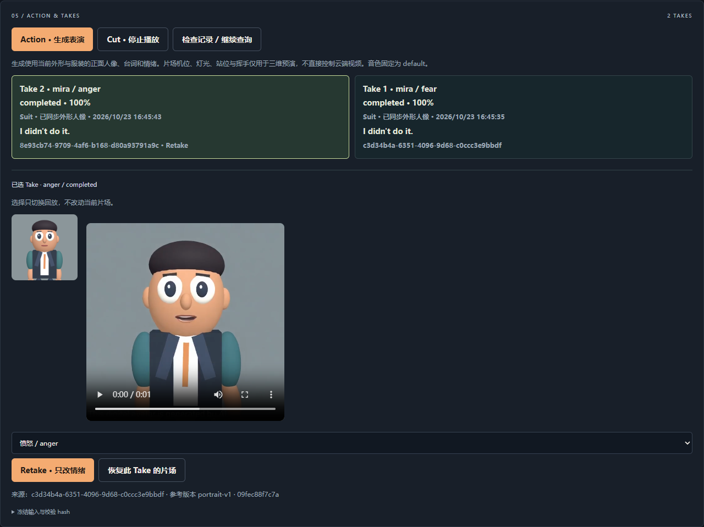

# AI Director Studio

Stage 5 · 可重复演示、双浏览器联调与本地交付。

首页支持中英文语音导演，并保留角色、外形、服装、动作、摄影机和灯光的手动控件。语音与按钮共用 SceneController / SceneStore；工具去重、原子复合操作、打断和断线恢复均已接入。Action 会冻结当前外形、服装、台词与情绪，生成可播放的 Take；Retake 只修改来源 Take 的情绪。第一阶段的诊断保留在 /lab。



## 演示与交付

一键准备演示、预生成回放标识、本地 MP4 归档、启动预检和独立测试环境已接入。见 [演示手册](docs/DEMO_RUNBOOK.md)、[第五阶段验收](docs/STAGE5_VALIDATION.md) 与 [交付说明](docs/DELIVERY.md)。真实物理设备与主观情绪、公开视频和远程交付 SHA 仍须分别验收。

```powershell
npm run doctor
pwsh -NoProfile -File scripts/start-local.ps1 -Mode demo
# 完整默认回归，真实生成服务与个人数据库不参与：
npm run verify
npm run test:clean
npm run release:info
```

## 本地启动

要求：Node.js 24+（本次使用 24.15.0，服务端使用内置 node:sqlite）、npm、支持 WebGL/AudioWorklet 的浏览器。真实媒体验证脚本额外需要 ffmpeg/ffprobe 在 PATH 中。

在 PowerShell 中：

```powershell
cd C:\Users\alida\Documents\Development\Boson26Director
npm ci
if (!(Test-Path .env.local)) { Copy-Item .env.example .env.local }
# 在 .env.local 设置 BOSON_API_KEY；不要加 NEXT_PUBLIC_ 前缀。
npm run dev
```

打开 http://127.0.0.1:3000。服务仅绑定本机地址。当前为本地单用户导演台与诊断工具；公开部署需要后续增加身份、用户任务归属与额度管理；当前 SQLite 任务记录面向本机单用户、单进程。

主密钥只由服务端读取。页面拿到的临时凭证只用于 Realtime 连接；不写入 localStorage、不显示在日志里。修改本地配置后重启服务。

## 表演与 Take 的使用顺序

1. 准备演员、外形、服装、台词和情绪，点击 Action，或连接语音后说“开始表演，Action”。
2. 生成使用冻结外形的固定正面人像；舞台机位、灯光、位置和 Wave 属于三维预演，不直接控制 Avatar 画面。
3. 在 Take 历史选择记录回放。选择不会改动舞台；生成结束也不会自动切换当前选择。
4. 选择来源 Take，设置 Retake 情绪并点击重拍，或说“保持其他不变，只改成愤怒，再来一次”。
5. Cut 停止本地视频与助手回复；生成中的云端任务继续运行。恢复来源片场需单独点击“恢复此 Take 的片场”。
6. 完成后点击“保存本地回放”，将原 MP4 原子保存到 .data/media，支持本地 Range 播放。供应商未归档的视频不保证永久可用。刷新和重启后从 .data/takes.sqlite 恢复记录、参考图和归档映射。

同一时间最多一个 Avatar 任务，Lab 也共享限制。未知提交不会自动重试；先检查历史和 Boson，可关联已确认的 video ID，或确认未接收后解除本地锁。详细错误恢复与测试证据见 [第四阶段验收报告](docs/STAGE4_VALIDATION.md)。

## 语音导演的使用顺序

1. 点击“连接语音导演”，允许麦克风，等到显示“已连接”后说话。
2. 例如：“换成 Ren，穿黑色西装，右转 45 度并挥手。”或“Move the camera a little closer.”
3. 查看识别内容与执行记录；不支持的服装/动作会解释原因，复合请求中任何一项失败都不改变场景。
4. 可以中途说下一条指令打断回复；按钮操作也会同步到语音上下文。
5. 点击“停止语音”释放麦克风与回复音频。已执行的场景修改保留，尚未提交的语音资产操作取消。

连接中会调用真实 Boson Realtime 和 STT 转写。录音、识别内容和临时凭证仅用于当前会话。网络恢复时申请新临时凭证、注入最新状态，不重放旧指令；连续连接失败最多重试两次。

详见 [第三阶段验收报告](docs/STAGE3_VALIDATION.md)。

## 手动导演台的使用顺序

1. 首页左侧选择 Mira / Ren，调整眼睛、脸宽与服装。替换演员会保留当前机位、灯光、台词和兼容参数。
2. 设置演员朝向，或点击左右转身按钮；Wave 播放一次后自动回到 Idle，重复点击会重新开始。
3. 右侧选择全景 / 中景 / 特写，调整距离、环绕、高度和 FOV。推近超出安全距离时会提示并保留机位。
4. 调整主光、补光、轮廓光、环境光与色调，或使用“审讯氛围”。
5. 在中间填写台词与情绪；它们属于场景状态，角色替换不会清空。
6. 下方开发诊断展示目标场景与实际渲染采样，并支持带校验的命令 JSON。批量命令整批成功才提交。

每个成功命令使 revision 增加一次；非法参数、不支持的能力或资产加载失败不会改变场景。加载新角色期间保留当前演员；失败后可以重试。当前场景在页面会话中保存，刷新会重置。

详见 [第二阶段验收报告](docs/STAGE2_VALIDATION.md)。

## 验证工作台的使用顺序

打开 http://127.0.0.1:3000/lab。

1. 切换 Mira / Ren，调整眼睛大小和脸宽，切换日常服装/西装及 Idle/Wave。底部能力摘要来自实际加载的 GLB。
2. 点击「截取角色人像」。拍摄使用独立正面相机；修改外形/服装后会提示重新截取。
3. 点击「连接麦克风」，允许权限后说一句话。听到回复后点击「停止连接」释放设备。本阶段仅验证对话，尚未接入导演工具。
4. 输入短台词，选择情绪，点击「试听 TTS 3」，再通过音频控件播放。
5. 首先选择官方示例人像验证 Avatar 协议，再选择当前角色截图验证风格化外观。每次点击会真实创建一个生成任务。
6. 等待任务完成后播放视频。自动轮询失败/超过等待时间时，用返回的 video_ ID 手动继续查询。Lab 刷新仅恢复最近一个 ID；主页另有完整持久化 Take 历史。Lab 新提交也记录为诊断 Take，标明人像未同步片场。

Avatar 输出为二维说话视频。当前 3D 视角、身体动画和房间场景不作为完整三维视频输入。生成画面中供应商会添加 AI 提示水印。

## 本地 API

| 方法与路径                    | 作用                                                                                                  |
| ----------------------------- | ----------------------------------------------------------------------------------------------------- |
| GET /api/diagnostics          | 配置是否存在、模型列表；不调用上游                                                                    |
| POST /api/realtime/session    | 输入 {}，获取短期凭证                                                                                 |
| POST /api/voice-preview       | 输入 {text, emotion}，返回 MP3 字节流                                                                 |
| POST /api/avatar              | 输入 {ref_image, input_tts: {text, emotion}, size}，返回任务对象；也支持白名单/内联音频 input，二选一 |
| GET /api/avatar/:id           | 查询 queued / in_progress / completed / failed                                                        |
| GET /api/avatar/:id/content   | 完成后代理 video/mp4；转发单段 Range（供应商也可合法返回完整 200）                                    |
| GET /api/takes                | 恢复完整本地历史                                                                                      |
| POST /api/takes               | {requestId, scene, portrait}，持久化后提交一次表演                                                    |
| POST /api/takes/retake        | {requestId, baseTakeId, overrides: {emotion}}，只改情绪                                               |
| GET /api/takes/:id            | 查询已记录的 Take；只更新对应任务                                                                     |
| GET /api/takes/:id/portrait   | 冻结的参考人像                                                                                        |
| GET /api/takes/:id/content    | 本地归档优先，否则同源流式代理                                                                        |
| POST /api/takes/:id/reconcile | 关联已核实的 videoId，或 {confirmedNotAccepted:true} 解除未知锁                                       |

emotion 为 neutral / fear / anger；台词限制 300 字。人像仅接受 Boson 官方示例地址或 PNG/JPEG/WebP data URI（约 2 MB 限制）。未开放任意远程人像 URL。

所有接口返回 no-store。错误返回 {error: {code, message}}，不会把上游原始错误或密钥反射给浏览器。付费创建请求不自动重试；网络超时或无法确认提交结果时显示 SUBMISSION_UNKNOWN 并禁用当前页面重复提交。Stage 4 已保存跨重启幂等映射和 Take 历史；服务重启不会重新创建付费任务。

新增接口：POST /api/takes/:id/archive（同源空 JSON，保存已完成视频，最大 50 MB）；GET /api/metrics（当前进程的脱敏计时，不含台词、ID 或凭证）。BOSON_DATA_DIR 可修改运行时数据目录，默认 .data。

## 测试

```powershell
npm run typecheck
npm run test:unit
npx playwright install chromium
npm run test:e2e
# 三浏览器演示要求已安装 Chrome / Edge：
npm run test:demo
npm run build
```

单元测试使用明确的上游 mock，验证请求协议、错误处理、无效输入不发请求、下载字节流、实际 GLB 顶点与骨骼、动画和 PCM 编码。浏览器默认测试使用本地媒体夹具及模拟 WebSocket，不调用付费服务；另有真实 GLB 画面和截图测试。

阶段四真实验收（最多两个 Avatar，有检查点避免重复提交）：

```powershell
npm run test:stage4
npm run test:stage4:e2e
# 保持本地服务运行；首次产生调用费用：
npm run test:stage4:live
```

历史第一阶段真实测试也会使用 .env.local 的密钥并产生调用费用：

```powershell
# 先执行浏览器测试，产出项目角色参考人像，再执行：
npm run test:live
# 保持 npm run dev 运行，在另一个终端执行：
npm run test:live:browser
```

真实脚本首次运行最多生成两段短 TTS、两段短 Avatar（官方人像/项目人像），另验证 Realtime 正常、无效及过期凭证。任务检查点写入被 Git 忽略的 docs/evidence/private/，重复运行优先复用已保存任务，不自动重复付费创建。若提交结果未知或人像发生变化，脚本会停止，需先检查原任务再决定如何重新验收。

真实浏览器测试复用已完成 Avatar，只额外生成一次 TTS；用之前生成的语音文件作为 Chromium 合成麦克风输入，经应用 AudioWorklet、真实 WebSocket 收到回复并调用 Web Audio 播放。这能验证采音处理链路，物理麦克风、声卡、耳机以及恐惧/愤怒的听感仍需现场验收。

测试夹具 tests/fixtures/ 的音视频为本地生成的单音/纯色画面，仅用于明确标记的模拟测试。真实结果独立保存，不混用。

## 角色资产

public/actors/ 内 Mira 与 Ren 为本仓库程序化生成的风格化角色，包含 33 个 mesh、7 个骨骼、FaceWidth / EyeSize 两个 morph、Casual / Suit 两套服装和 Idle / Wave 动画。许可及来源见 public/actors/LICENSE.txt 与 manifest.json；未使用第三方人物模型或纹理。

```powershell
npm run assets:generate
```

会从 scripts/generate-actors.ts 重新导出两个 GLB 和包含 SHA-256 的清单。模型是能力验证用的简洁资产，后续可换成具有同等能力的精细角色。

## 本阶段验收记录

见 [Stage 4 验收报告](docs/STAGE4_VALIDATION.md)、[Stage 3 验收报告](docs/STAGE3_VALIDATION.md)、[Stage 2 验收报告](docs/STAGE2_VALIDATION.md)、[Stage 1 验收报告](docs/STAGE1_VALIDATION.md)、[五阶段开发方案](DEVELOPMENT_PLAN.md) 与 [原始 handoff](PROJECT_HANDOFF_AI_DIRECTOR_STUDIO.md)。

协议依据：[Boson Realtime](https://docs.boson.ai/api-reference/realtime/client-events)、[Realtime 服务器事件](https://docs.boson.ai/api-reference/realtime/server-events)、[Avatar 输入](https://docs.boson.ai/models/higgs-avatar/input-options)、[TTS 标签](https://docs.boson.ai/models/higgs-tts/tags)。
